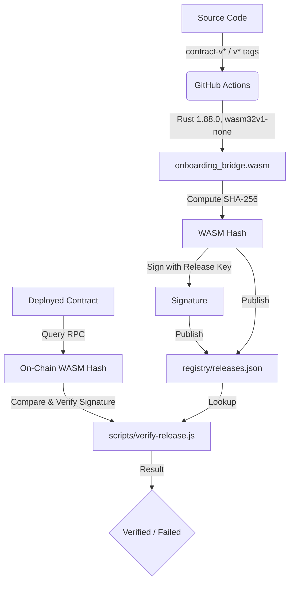

# Soroban Contract WASM Verification Guide

This repository documents how to build and verify the **C-Address Onboarding Bridge** Soroban smart contract.

`wasm_hash.txt` is the SHA-256 hash of `onboarding_bridge.wasm`, built for `wasm32v1-none` with Rust 1.88.0 from `rust-toolchain.toml`. CI and release workflows build and verify that same artifact. The release signing script can publish a matching hash and signature to the verification registry.

---

## Architecture Overview



---

## 1. Release tag convention

`contract-v*` is the canonical contract release path. The [publish.yml](.github/workflows/publish.yml) workflow verifies the pinned WASM artifact, publishes the crate, and creates the GitHub Release. The [release.yml](.github/workflows/release.yml) `v*` workflow is retained as a legacy artifact-only path; it also builds and verifies the same artifact but does not publish the crate.

## 2. Continuous Integration (CI) Verification

In every PR and push to `main`, [ci.yml](.github/workflows/ci.yml) builds the contract WASM using Rust 1.88.0 and `wasm32v1-none`, then verifies its SHA-256 hash against [wasm_hash.txt](wasm_hash.txt):

```bash
cargo build -p onboarding-bridge --release --target wasm32v1-none
COMPUTED_HASH=$(sha256sum target/wasm32v1-none/release/onboarding_bridge.wasm | cut -d' ' -f1)
KNOWN_HASH=$(cat wasm_hash.txt | xargs)
test "$COMPUTED_HASH" = "$KNOWN_HASH"
```

If you intentionally modify the contract or change the pinned toolchain, rebuild with the pinned toolchain and update `wasm_hash.txt` to match.

---

## 3. Release Registry

The [scripts/sign-release.js](scripts/sign-release.js) script signs the pinned WASM hash using `RELEASE_SIGNING_KEY` and writes release metadata to [registry/releases.json](registry/releases.json). This registry-signing step is separate from the GitHub Actions release workflows.

---

## 3. Independent Verification

### Verify a Deployed On-Chain Contract

Any user can query the blockchain to verify that a deployed contract matches an official release.

Run the verification script:

```bash
# Verify contract on Testnet (default)
NODE_PATH=sdk/node_modules node scripts/verify-release.js --contract <CONTRACT_ADDRESS>

# Verify contract on Mainnet
NODE_PATH=sdk/node_modules node scripts/verify-release.js --contract <CONTRACT_ADDRESS> --network public

# Verify contract on a custom RPC
NODE_PATH=sdk/node_modules node scripts/verify-release.js --contract <CONTRACT_ADDRESS> --rpc-url https://your-rpc-endpoint.com
```

### Verify a Local WASM File

If you built the WASM locally and want to verify it against the registry before deploying:

```bash
NODE_PATH=sdk/node_modules node scripts/verify-release.js --wasm target/wasm32v1-none/release/onboarding_bridge.wasm
```

---

## Verification Output Example

When verification succeeds, the script outputs:

```text
Connecting to Soroban RPC: https://soroban-testnet.stellar.org
Fetching ledger entry for contract: CC...

==============================================
Verification Source: On-chain contract (CC... on testnet)
SHA-256 WASM Hash:   ded391f4f18fc1459b77c06caecb18109b7c112a3dff923cfc409c23064d6b15
==============================================

✓ Hash found in registry!
  Release Version: v0.1.0
  Commit SHA:      8f4b2a...
  Timestamp:       2026-06-30T08:00:00.000Z
✓ Cryptographic signature is VALID!
  Signed by: G...

🎉 SUCCESS: The contract is VERIFIED against audited release v0.1.0!
```
